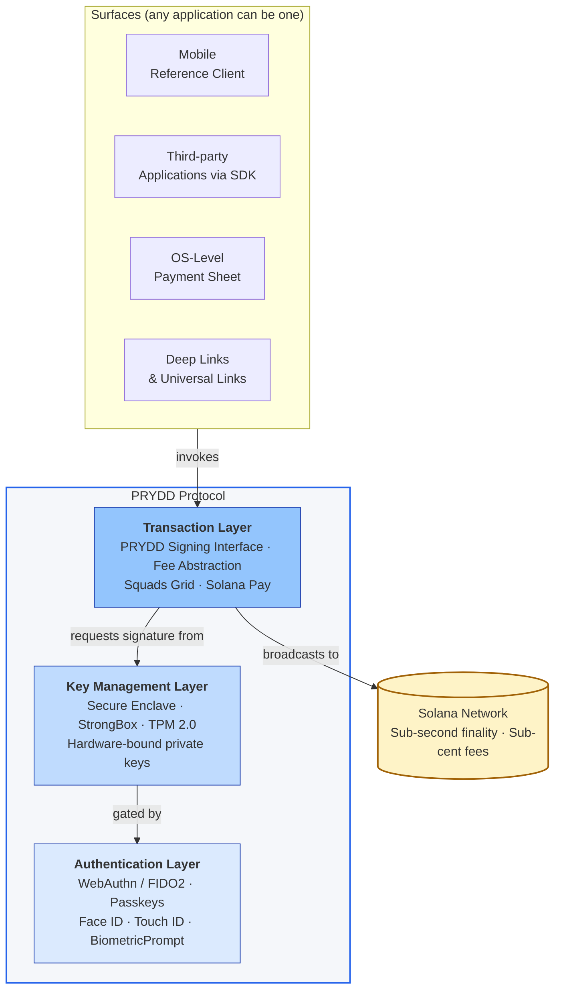
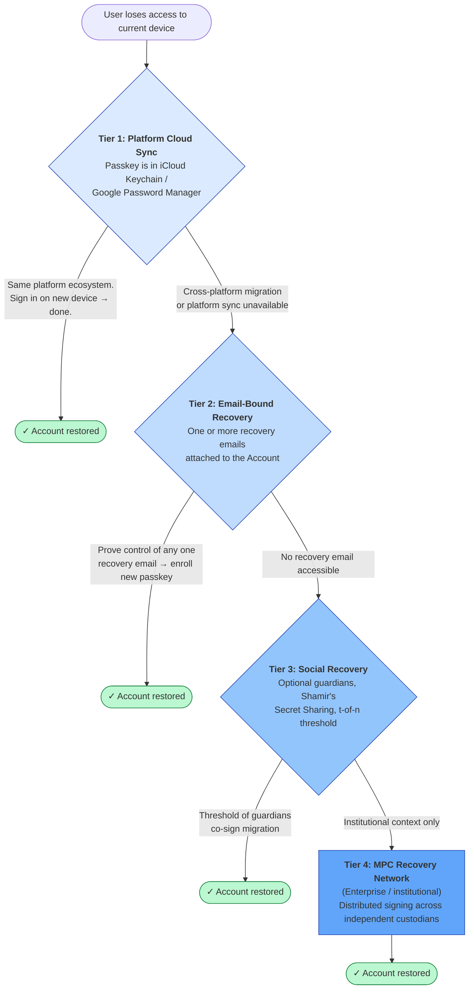
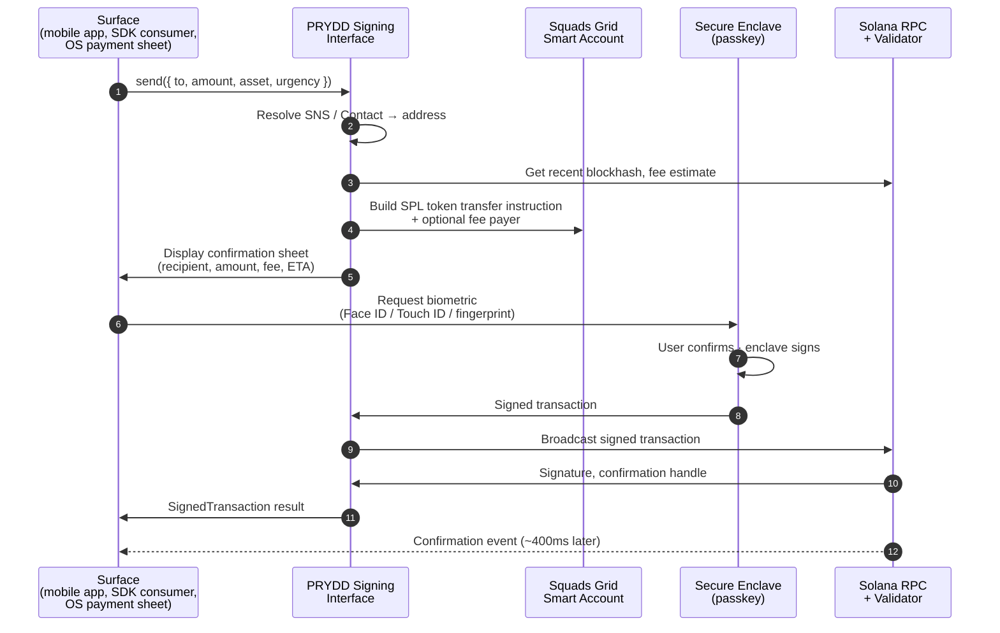
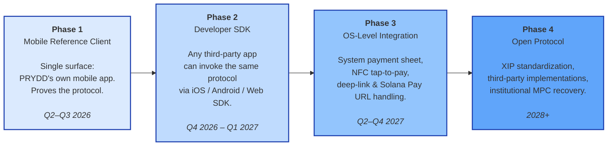

# PRYDD

### *OS-Level Payment Infrastructure on Solana*

**A Protocol for Embedded, Native Digital Asset Transactions**

**Litepaper · v1.0 · May 2026**

---

> *"If blockchains are working right, they should be invisible."*
>
> — **Anatoly Yakovenko**, Co-founder, Solana Labs · *The Brainstorm* podcast (ARK Invest), 2025

---

## 1. Abstract

PRYDD is an open payments protocol that embeds cryptocurrency signing and settlement directly into the layers of the device where authentication, hardware key storage, and operating-system intent handling already live. Rather than requiring a person to navigate between an application and an external wallet, and rather than requiring a developer to rebuild key management, account recovery, and on-chain integration inside every product, PRYDD exposes a single, hardware-backed, biometrically authenticated transaction layer that any application can invoke through a unified interface.

The protocol is built on Solana. Every Account is a Squads Grid embedded smart account, authorized by a passkey that lives in the user's platform keychain and is bound to the secure hardware on their device. Every payment is a Solana transaction, settling in roughly a second, at a cost measured in cents. Every fee can be sponsored by the application invoking the payment, so that a person sending USDC does not need to hold SOL — and, in most cases, does not need to know SOL exists.

The protocol is exposed to applications through three concentric surfaces: a reference mobile client that proves the protocol works for an end user, a developer SDK that lets any third-party application invoke the same protocol from inside its own product, and an OS-level integration layer that allows the operating system itself to route payment intents into the protocol the way it routes Apple Pay or contactless tap-to-pay today. This litepaper describes the architecture, the security and recovery model, the developer interface, and the staged roadmap by which these surfaces will ship.

---

## 2. The Problem

### 2.1 The UX Gap

Cryptocurrency has achieved extraordinary technological maturity. Modern networks process thousands of transactions per second at sub-cent cost. Stablecoins have become a genuine settlement medium. Account abstraction, embedded smart accounts, and hardware-backed authenticators have all reached production. And yet the experience of sending fifteen dollars in cryptocurrency to another person remains an order of magnitude harder than the equivalent action on any modern fiat payment rail.

The cause of this is not the blockchain. The cause is that the wallet has remained an application — something a user must open, manage, secure with a seed phrase, and consciously switch to whenever any other application wants to move on-chain value — when it should have become infrastructure.

> *"The next 10 years are going to be about really upgrading the ecosystem at the user level. Let's make something people in the world's lower-income countries can actually go ahead and use."*
>
> — **Vitalik Buterin**, Co-founder of Ethereum · BUIDL Asia keynote, September 2023

A user attempting a crypto payment today must open a dedicated wallet, navigate to a send screen, paste a base58 or hexadecimal address, select the correct network from a list, hold a small balance of a native gas token, estimate fees, confirm the transaction, and wait for confirmation. If the user began that journey inside a chat thread, a video stream, or a checkout flow, they must leave the original context entirely, complete the multi-step process, and return — by which point the moment that prompted the payment has frequently evaporated. Each application that wants to support crypto payments must either accept this experience or rebuild the entire wallet stack itself.

### 2.2 What Apple Cash Got Right

Apple Cash solved the equivalent problem in the fiat world by refusing to be an application at all. When an iOS user types "$15" inside iMessage, the operating system recognizes the payment intent, presents an inline payment sheet, authenticates the sender with Face ID, and settles the transaction through Apple Pay infrastructure. The user never leaves the conversation. The payment is part of the message.

This works because Apple controls and tightly integrates three otherwise-separate layers: Secure Enclave for hardware-bound key storage, Face ID / Touch ID / passkeys for biometric authentication, and system-level intent handling that lets any application on the device invoke the payment primitive without building payment infrastructure itself. The user thinks of the experience as a single gesture. The platform stitches it together from three.

### 2.3 The Missing Layer in Crypto

Cryptocurrency, today, has nothing equivalent to this stack. There is no standard mechanism by which an operating system manages on-chain keys in hardware-protected enclaves on behalf of arbitrary applications. There is no protocol by which an application requests a transaction signature without launching an external wallet. There is no consistent abstraction that lets a developer say "send fifteen USDC to this recipient" and have the platform handle everything else.

Each of these gaps is filled, today, by a partial solution: a wallet here, an embedded SDK there, a deep link, an iframe, a browser extension. None of these compose into the equivalent of Apple Cash, because none of them lives at the layer where Apple Cash lives. They are applications about payments. PRYDD is the platform layer beneath them.

---

## 3. Why Now, Why Solana

Three independent currents have converged in the last twenty-four months and made the protocol layer PRYDD describes possible to build for the first time. The first two are general to all consumer devices. The third is specific to Solana.

### 3.1 The Convergence of Platform Authenticators

WebAuthn and FIDO2 passkeys are now natively supported on every major mobile and desktop operating system, and they synchronize across a user's devices through platform-native keychains — iCloud Keychain on Apple devices, Google Password Manager on Android, equivalent stores elsewhere. The platforms have shipped the hard pieces: hardware key generation, biometric prompts, origin binding, cross-device sync. The cryptographic primitive a protocol like PRYDD needs in order to replace seed phrases with biometric confirmation is no longer hypothetical. It is sitting one API call away on every modern device.

### 3.2 The Production-Readiness of Hardware Key Storage

The Secure Enclave on Apple platforms, StrongBox-backed Keystore on Android, and TPM 2.0 on Windows are all now broadly deployed, broadly documented, and broadly integrated with their respective platform authenticators. The same hardware that protects an Apple Pay credential or a FIDO2 security key can be used to operate the private keys that authorize on-chain transactions — without those keys ever existing in application memory, persistent storage, or the host operating system kernel. The same security guarantees that consumers already trust for banking app logins are the guarantees PRYDD inherits for crypto payments.

### 3.3 Solana as Payments-Grade Settlement

A protocol of the kind PRYDD describes can be built on any chain whose throughput, finality, and economics support consumer-scale, latency-sensitive transactions. As of today, there is one such chain at production scale, and there is one ecosystem in which the embedded smart-account, passkey-binding, and fee-sponsorship primitives needed to make the protocol work have shipped as composable infrastructure.

Solana settles transactions in roughly four hundred milliseconds at sub-cent cost. It processes consumer-scale throughput on a single global state machine, without requiring users or developers to choose between L1 and a constellation of L2s. Its native token economics allow for delegated fee payment as a first-class primitive — any account can pay the network fee on behalf of any other account, on any transaction, with no extra contract layer required. Its embedded smart-account ecosystem, anchored by Squads Grid, exposes passkey-bound account authorization, native recovery, and programmable session keys directly to applications. Its name service, SNS, gives every account a human-readable handle. And its existing payments-protocol surface — Solana Pay — already standardizes the transaction-request URL format that a system-level payment sheet can route into.

> *"Humans don't do that much stuff per day. If everybody was using \[Bitcoin] for payments, it would fall over. If we're talking about a global settlement layer for this world's reserve thermodynamic money, it's actually pretty good."*
>
> — **Anatoly Yakovenko**, Co-founder and CEO of Solana Labs · *Acquired* podcast, June 2021

That observation — that a network optimized to be a settlement layer for a reserve asset is structurally a different network from one optimized to carry consumer payments at human-scale frequency — is the engineering thesis Solana was built on. Five years later, the chain has the throughput, the fees, the finality, and the account-model surface area to be the rail beneath an OS-level payments protocol. PRYDD takes that thesis at face value.

> *"Blockchains have always been and always will be tech for finance… financial rails first and foremost."*
>
> — **Lily Liu**, President of the Solana Foundation · CoinDesk, February 2026

### 3.4 The Build Window

Each of these three currents existed in some form a year or two ago. None of them, in production, on a single platform, in a form a protocol could compose, did until very recently. The cost of waiting compounds: every quarter that the layer between platform authenticators, hardware enclaves, and a payments-grade chain remains unbuilt is another quarter in which the wrong solutions — siloed embedded wallets, custodial workarounds, region-specific payment apps — fill the vacuum and harden in place. PRYDD exists because all three currents have arrived at the same point at the same time, and the layer between them has not yet been built.

---

## 4. PRYDD Protocol Architecture

### 4.1 Architectural Overview

The PRYDD protocol is organized into three layers, each addressing a distinct concern in the lifecycle of a cryptocurrency payment. The separation is deliberate. Changes to authentication mechanisms, to the underlying chain's account model, or to the surfaces that consume the protocol do not cascade across the system. Each layer can evolve, be replaced, or be reimplemented independently.



***Figure 1.** The PRYDD protocol stack. The three core layers are independent of each other and independent of the surfaces above and the network below. Any client can invoke the protocol. The protocol always signs in hardware, always authenticates with a passkey, and always broadcasts to Solana.*

| Layer | Responsibility | Realized through |
| --- | --- | --- |
| Authentication | Identifying the user; binding intent to a verified human; preventing phishing and replay | WebAuthn / FIDO2 passkeys, Face ID, Touch ID, Android BiometricPrompt, Windows Hello |
| Key Management | Generating, storing, and operating the private key that controls the user's Account; never letting that key leave hardware | Apple Secure Enclave, Android StrongBox / TEE, Windows TPM 2.0, platform authenticators on the web |
| Transaction | Constructing, signing, sponsoring fees on, and broadcasting Solana transactions on behalf of an authenticated user | PRYDD Signing Interface (XSI), Squads Grid smart accounts, Solana fee-payer transactions, Solana Pay URL handling |

### 4.2 The Authentication Layer

The authentication layer replaces seed phrases, exported private keys, and bespoke wallet login flows with a hardware-backed biometric verification gesture expressed through the WebAuthn/FIDO2 standard. When an application invokes a transaction, PRYDD generates a cryptographic challenge that the device's platform authenticator resolves through a biometric prompt — a glance at Face ID, a touch of a fingerprint sensor, a tap of Windows Hello, an Android `BiometricPrompt` confirmation. The authenticator's private key never leaves the secure hardware on which it was generated. Only a signed assertion is returned to the relying party.

This construction provides phishing resistance through cryptographic origin binding. A passkey only resolves challenges for the origin it was originally enrolled with, which makes it impossible for a malicious site to replay an authentication request against another relying party. For developers, this means no password handling, no OAuth token plumbing, no session-hijacking surface area. For users, it means the same gesture they already use to unlock their phone or sign into a banking app is the same gesture that authorizes a payment.

> *"Passkeys now are, I would say, the most elegant, seamless solution. The best way to actually get people in a truly passwordless form of authentication that's not dependent on any sort of knowledge based credentialing or any phishable methodology — so integrated into the devices and operating systems that we use on a daily basis."*
>
> — **Andrew Shikiar**, Executive Director and CMO, FIDO Alliance · *Crack the Code with Passkeys* podcast, 2024

Passkeys synchronize across the user's devices through platform-native cloud keychains, end-to-end encrypted such that the platform provider cannot read the credential material itself. A user who enrolls PRYDD on their iPhone is automatically present on their iPad, their Mac, and their watch — mirroring the cross-device behavior of Apple Cash exactly. A user on an Android device is similarly present across every Android surface signed into the same Google account.

### 4.3 The Key Management Layer

The key management layer is the security-critical core of the protocol. It operates entirely within hardware-protected environments. Private-key material never exists in application memory, never touches persistent storage outside the secure element, and is never accessible to the host operating system kernel.

The fundamental design decision in this layer is that PRYDD Accounts on Solana are *not* externally owned accounts in the classical sense. They are Squads Grid embedded smart accounts whose authorization is bound to a passkey-derived public key. The passkey lives in the platform authenticator and is gated by the user's biometric. When a transaction needs to be signed, the unsigned transaction is presented to the authenticator, which performs the signing operation inside the secure enclave and returns the signed result. The application never sees the private key. The operating system never sees the private key. The protocol operator — PRYDD itself — never sees the private key.

Where the platform exposes the right primitives, PRYDD uses the passkey-derived credential directly as the smart account's authorization key. On Solana specifically, this means that the Squads Grid account's signing authority resolves to a P-256 public key whose corresponding private key lives inside the Secure Enclave or StrongBox on the user's device. There is no separate seed phrase, no master mnemonic, no exported wallet artifact to lose or compromise.

| Platform | Hardware module | Key isolation | Biometric binding |
| --- | --- | --- | --- |
| iOS / macOS | Apple Secure Enclave | Keys generated and operated exclusively within the secure coprocessor | Face ID / Touch ID mandatory for every signing operation |
| Android | StrongBox-backed Keystore or TEE | Keystore enforces hardware-backed key generation on compatible devices | Biometric prompt via Android `BiometricManager` |
| Windows | TPM 2.0 | TPM-bound keys with attestation certificates | Windows Hello (face, fingerprint, or PIN) |
| Browser | Platform Authenticator | Delegated to device hardware via WebAuthn | Platform-dependent passkey prompt |

### 4.4 The Transaction Layer

The transaction layer is the chain-facing surface of the protocol. It exposes a single signing interface — the **PRYDD Signing Interface**, or **XSI** — into which surfaces submit standardized transaction intents and from which they receive signed, broadcast-ready Solana transactions. Behind the interface, PRYDD constructs the appropriate Solana transaction (a system program transfer, an SPL token transfer, a Token-2022 transfer, an instruction targeting an arbitrary program), fetches a recent blockhash, attaches the appropriate fee payer, submits the unsigned transaction to the key management layer for signing, and broadcasts the signed result through a configured RPC.

The intent shape is intentionally minimal:

```ts
interface TransactionIntent {
  // The recipient. May be a Solana address (base58), an SNS name like
  // "gift.sol", or a saved Contact reference resolved by the SDK.
  to: string;

  // The amount, in the asset's display unit (e.g. "15.00" for 15 USDC).
  // The transaction layer handles conversion to the on-chain base unit
  // (lamports for SOL, raw amounts for SPL tokens) before signing.
  amount: string;

  // The asset being moved. "USDC" by default. May be any SPL token
  // mint address or a registered token symbol.
  asset?: TokenIdentifier;

  // Optional arbitrary program calldata, for advanced flows that need
  // to invoke a Solana program directly (e.g. a swap, a stake, a
  // governance vote). The intent shape stays uniform across simple
  // transfers and complex program interactions.
  data?: ProgramInvocation;

  // A hint to the fee-estimation logic. "high" prioritizes inclusion
  // in the next slot; "low" tolerates a few seconds of additional
  // latency for a marginally lower compute-unit price.
  urgency?: "low" | "medium" | "high";
}
```

The result is a `SignedTransaction` that includes the signed transaction bytes, the transaction signature, a confirmation handle that the surface can subscribe to, and any chain-specific metadata an application may want to surface to the user.

Because the protocol is Solana-only, the transaction layer can be deeply integrated with Solana-native primitives rather than implementing a lowest-common-denominator abstraction. This is covered in detail in Section 6.

---

## 5. Security and Recovery Model

### 5.1 Threat Model

PRYDD's security model addresses four primary categories of threat.

The first is **key extraction** — any attempt to export the user's private-key material from the device. This is mitigated by hardware enclave isolation. The signing key for the user's Squads Grid Account exists only inside Secure Enclave, StrongBox, or the equivalent hardware module on their device. It is generated there, used there, and discarded there. No code path, on or off the device, can request the key itself; only signed assertions can be requested, and only with a successful biometric confirmation.

The second is **transaction tampering** — any modification of transaction parameters between the moment a user expresses intent and the moment a signature is produced. This is mitigated by end-to-end transaction construction: the transaction is fully constructed and rendered to the user in human-readable form (recipient, amount, asset, fee) before the signing request enters the enclave. What the user confirms is what the enclave signs.

The third is **phishing and social engineering** — any attempt to trick a user into signing a transaction whose effect differs from their understanding. This is mitigated by WebAuthn origin binding (the passkey only resolves challenges for the origin it was enrolled against) combined with a mandatory confirmation step that surfaces the substance of the transaction in plain language. A protocol-level guarantee that the user cannot be silently transitioned from a transfer flow to a contract-approval flow is enforced.

The fourth is **device compromise** — full operating-system-level malware on the user's device. This is mitigated by the architectural reality that even a fully compromised host operating system cannot extract keys from the secure enclave, and that every signing operation still requires a fresh, hardware-mediated biometric confirmation that malware cannot simulate or replay.

### 5.2 Recovery Architecture

Key loss is the single largest cause of cryptocurrency asset loss, and the place where most non-custodial products fail in the wild. PRYDD's recovery model is designed so that the default case is effortless, the secondary case is human-readable, and the failure cases — even the worst of them — are survivable.

> *"\[Seed phrases] are not good enough… hardware wallets alone are not good enough… multi-sig is good… social recovery is better."*
>
> — **Vitalik Buterin**, Co-founder of Ethereum · *Why we need wide adoption of social recovery wallets*, January 2021



***Figure 2.** PRYDD recovery tiers, listed from default to last resort. The default path is effortless and platform-native. Each subsequent tier exists as a fallback for the failure of the previous one.*

**Tier 1 — Platform cloud sync (default).** A user's passkey synchronizes through iCloud Keychain, Google Password Manager, or the equivalent for their platform. Migrating to a new device within the same ecosystem requires no recovery flow at all: the user signs into the device with their existing platform credentials, the passkey is already present, and PRYDD resumes. The cloud sync is end-to-end encrypted; neither the platform provider nor PRYDD has access to the underlying credential.

**Tier 2 — Email-bound recovery.** Each Account is associated with one or more recovery emails controlled by the user. Re-authentication on a new device, or across platform boundaries (Apple to Android, for instance), is driven by proving control of one of these emails, after which the user enrolls a new passkey and rebinds the Account. There is no twelve-word mnemonic, no recovery code printed on paper, no separate vault to lose. The permanent-lockout case is reachable only by explicitly deleting the Account through a deliberate, friction-loaded flow.

**Tier 3 — Social recovery (optional).** Users may designate trusted guardians, each of whom holds a cryptographic share of a recovery key constructed using Shamir's Secret Sharing. A configurable threshold of guardians can reconstruct the recovery key and authorize migration to a new device. No individual share is cryptographically useful on its own; guardians need not be technically sophisticated, and they cannot collude with fewer than the threshold number to access the user's Account.

**Tier 4 — MPC recovery network (institutional).** For deployments where platform-native recovery is unacceptable for regulatory or operational reasons, PRYDD supports Multi-Party Computation recovery, in which key shares are distributed across geographically and jurisdictionally separated nodes operated by independent custodians. Recovery requires a threshold of nodes to participate in a distributed signing ceremony, providing key recoverability without any single point of compromise.

### 5.3 Audit and Compliance

Every signing operation produces a cryptographic attestation that the transaction was signed inside a hardware enclave with a successful biometric confirmation, without revealing the key material itself. These attestations are designed to enable selective disclosure to auditors, compliance systems, and regulators where required — consistent with KYC and AML reporting obligations — while leaving the user in control of what is disclosed and to whom.

---

## 6. The Transaction Layer in Detail

### 6.1 The PRYDD Signing Interface

The XSI is the developer-facing API for requesting transaction signatures. It accepts the `TransactionIntent` shape described in Section 4.4 and returns a `SignedTransaction`. Behind that single call, the transaction layer performs the entire lifecycle of a Solana payment.



***Figure 3.** The transaction lifecycle, from intent to confirmation. The most important property of this flow is that the private key never leaves the Secure Enclave — only the signed transaction does.*

The application writes a single function call; the protocol handles SNS resolution, blockhash retrieval, fee estimation, transaction construction, biometric confirmation, hardware signing, RPC broadcast, and confirmation subscription. The user taps Face ID once. The transaction settles in roughly four hundred milliseconds.

### 6.2 Fee Abstraction

One of the most acute usability barriers in cryptocurrency payments is fee management. A user sending USDC should not need to hold SOL to pay the network fee. A user sending any SPL token should not need to think about gas at all. The transaction layer handles this transparently through three coordinated mechanisms native to Solana.

The first is **fee payer separation**. Solana transactions explicitly designate a fee-payer account, which need not be the same account that signs the transaction. PRYDD's transaction layer can therefore construct transactions in which the user's Squads Grid Account is the transaction's signer and a PRYDD-operated paymaster (or an application-operated paymaster) is the fee payer. The user holds zero SOL and still transacts.

The second is **deducted fees from the transfer asset**. Where the application prefers, the transaction layer can construct a single bundled transaction in which the fee is taken in the same asset as the transfer — for example, by swapping a small portion of USDC into SOL atomically as part of the transaction — eliminating the paymaster pattern entirely for self-funded use cases.

The third is **fee estimation and prioritization**. The SDK exposes real-time predictions of inclusion time at three urgency tiers, returned alongside the unsigned transaction so the confirmation sheet can surface an honest expectation of how quickly the payment will settle. On Solana, the prioritization knob is the compute-unit price; PRYDD abstracts this into a simple three-level dial.

The combined effect is that the words "gas," "SOL for fees," and "priority fee" never need to appear in the user-facing surface of any application built on PRYDD.

### 6.3 Squads Grid and Account Programmability

Every PRYDD Account is a Squads Grid embedded smart account. The shift from a classical externally owned address to a programmable smart account is what unlocks several features that distinguish PRYDD from a classical wallet stack.

**Batched transactions** allow approve-and-swap or approve-and-send sequences to settle inside a single user confirmation, eliminating the multi-step transaction sequences that fragment crypto UX today. **On-chain spending limits**, set by the user themselves, give a hard upper bound on outflows per period, enforced by the smart account regardless of which application is invoking it. **Session keys** allow time-bounded, amount-capped signing permissions for recurring payments — a user authorizes a $9.99-per-month subscription for twelve months, and subsequent charges execute without repeated biometric prompts, with the smart account itself enforcing the bound. **Sponsored transactions**, as described above, allow an application to pay fees on behalf of its users without compromising the underlying account model. **On-chain recovery logic**, where used, lets the social recovery path of Tier 3 be enforced by the smart account rather than by an off-chain operator.

The smart account is deployed lazily — only when the user's first transaction requires it — so there is no upfront cost imposed on a user who creates an Account but never moves funds.

### 6.4 Solana-Native Surfaces

The transaction layer interoperates with two existing Solana-native standards that allow PRYDD to participate in the broader ecosystem without requiring custom integration on every surface.

**Solana Pay** is the existing standard URL format for transaction requests on Solana. A merchant or application can generate a `solana:` URL describing a payment (recipient, amount, asset, reference), and any wallet that handles the format can complete it. PRYDD handles Solana Pay URLs natively, which means that a QR code or deep link generated by any Solana Pay-compliant merchant can be paid through a PRYDD Account with a single Face ID confirmation. This also means that the existing universe of Solana Pay-integrated point-of-sale terminals, e-commerce checkouts, and creator-tipping flows works with PRYDD on day one, with no merchant-side integration changes.

**Solana Name Service (SNS)** provides human-readable handles for Solana accounts. PRYDD resolves SNS names — `gift.sol`, `prydd.sol` — natively inside the transaction layer, so an application can present a recipient as a name rather than a base58 address, and the user can send to a name without ever copying or pasting a public key. This is the addressable-by-name property that fiat payment apps have always taken for granted and that on-chain payments have, until now, lacked.

---

## 7. Surfaces of the Protocol

The PRYDD protocol is not an application. It is a layer of the device that applications invoke. Several distinct surfaces consume the protocol, none of which is privileged over the others — they are simply different shapes the protocol can take in the hands of different products.

### 7.1 The Mobile Reference Client

The first surface to ship is a mobile client, built by PRYDD, that exercises the entire protocol end-to-end and serves as the proof-of-concept reference implementation for everyone who builds on it afterward. The mobile client lets a person create an Account, hold their balance, send to other Accounts, send to Solana addresses or SNS names, receive payments, and recover their Account across devices. It is a fully functional consumer payments application. It is also, deliberately, only one of many possible clients of the protocol. The protocol is not the mobile app; the mobile app is one shape the protocol can take.

### 7.2 The Developer SDK

The second surface is the SDK that allows any third-party application to invoke the protocol from inside its own product. The SDK ships for iOS (Swift), Android (Kotlin), web (TypeScript), and cross-platform frameworks (React Native, Flutter). Each SDK exposes the same core API, adapted to platform idioms.

Initialization is a single object:

```ts
import { PRYDD } from '@prydd/sdk';

const prydd = new PRYDD({
  appId: 'your-app-id',
  environment: 'mainnet',
});
```

Sending a payment is a single call:

```ts
const result = await prydd.send({
  to: 'gift.sol',          // SNS name, address, or saved Contact
  amount: '15.00',
  asset: 'USDC',
  urgency: 'medium',
});
// result.signature → Solana transaction signature
// result.status    → 'confirmed' once finalized
// result.explorerUrl → solscan / solana.fm link
```

Behind those five lines the SDK performs SNS resolution, fee estimation, biometric authentication, enclave signing, transaction construction, and broadcast. The developer writes the application; the protocol handles the payment.

> *"When you open a 'dapp' inside a wallet, it should automatically know who you are, and how to push a payment request to you — this was a big driver of growth for WeChat apps for instance (no signup or adding a payment method)."*
>
> — **Brian Armstrong**, Co-founder and CEO of Coinbase · Twitter, March 2020

This is the property the SDK exposes to every application that integrates it. A user who has a PRYDD Account does not sign up again to use a new application; they authenticate with their existing passkey, and the application gains the ability to request payments from them, subject to whatever per-application limits the user has configured.

### 7.3 Integration Patterns

The same SDK supports several distinct application shapes. *Inline payments in messaging clients* use a payment composer component that renders inside the message input area, generalizing the Apple-Cash-inside-iMessage pattern to any chat surface. *Tipping overlays for social and creator platforms* use a browser-extension and mobile-WebView injection layer that detects content-creator profiles and renders a floating tip control. *Point-of-sale and e-commerce checkout* uses a payment-request API modeled on the W3C standard, presented to the user as a payment sheet with biometric confirmation. *Recurring payments and subscriptions* use session keys whose bounds are enforced by the smart account itself, so a user authorizes a subscription once and the application executes against it without repeated prompts. *DeFi access for advanced users* uses the optional `data` field on `TransactionIntent` to submit arbitrary program calldata, allowing swaps, staking, lending, and governance interactions through the same biometric-authenticated signing flow.

### 7.4 Deep Links and System Integration

The third surface — the one that will ship in Phase 3 — is OS-level integration. PRYDD registers a system URL scheme and universal-link handler that lets any application on the device, including ones that have not integrated the SDK, invoke a PRYDD payment by simply opening a URL:

```
prydd://send?to=gift.sol&amount=15.00&asset=USDC
```

The operating system routes the request to the PRYDD payment sheet, which handles authentication, signing, and broadcasting, and returns control to the originating application. The pattern mirrors the way Apple Pay can be invoked from a URL, an NFC tap, or a Wallet pass without an application embedding the payments stack itself. Combined with Solana Pay URL handling (Section 6.4), this means any Solana payment request — generated by any merchant, anywhere — becomes payable through a PRYDD Account with a single biometric confirmation, regardless of which application generated the request.

---

## 8. Why PRYDD Is Different

Three positioning differences distinguish PRYDD from the categories adjacent to it.

### 8.1 vs. Conventional Digital Banking Products

A digital banking application, however well-designed, is structurally an interface over a fiat-denominated balance sheet held by a regulated institution and moved over correspondent banking rails. The account is an entry in a database. The transfer is a message routed between institutions. Cross-border settlement requires a corresponding institution at the other end of the route. PRYDD, by contrast, does not operate a balance sheet at all. The user's Account is a programmable smart account on a public network. The user's funds are on-chain assets they themselves hold. The rails are the public chain on which those assets live. PRYDD the protocol cannot freeze a user's funds, cannot reverse a confirmed transaction, and cannot lose the user's Account in an internal-systems failure, because none of those operations are reachable from the protocol's surface.

### 8.2 vs. Conventional Cryptocurrency Wallets

A wallet, however well-designed, is an application. It is something a user opens, manages, secures with a seed phrase, and consciously switches to whenever any other application wants to move on-chain value. The mental model is one of holding and moving tokens, and the vocabulary — wallet, address, gas, approve, mnemonic, chain — is the vocabulary of an engineer interacting with a network, not of a person making a payment. PRYDD is not an application. It is a layer of the platform, and the applications that invoke it never expose that vocabulary to the user. Where a wallet asks the user to back up a seed phrase, PRYDD binds the Account to a passkey and a recovery email the user already manages. Where a wallet asks the user to hold a gas token, PRYDD abstracts the fee away through Solana's fee-payer primitive. Where a wallet asks the user to confirm a contract approval, PRYDD's smart-account model expresses authorization as a session key with explicit, on-chain-enforced bounds.

### 8.3 vs. Embedded-Wallet SDKs

Embedded-wallet products solve a similar adjacent problem — they let developers ship a wallet inside an application without building one from scratch — but they remain bound to the application that embeds them. Each integration is its own silo. Two applications using the same embedded-wallet provider still produce two separate user-facing accounts, two separate authentication flows, two separate balances. PRYDD's positioning is the opposite. The Account is bound to the user's device and the user's passkey, not to any individual application. Every application that invokes the protocol invokes the same Account. The user's experience of "their PRYDD Account" is portable across every product that integrates the protocol, in the same way the user's experience of "their Apple Pay" is portable across every merchant that accepts it.

The cumulative effect of these three differences is that PRYDD occupies a layer of the stack that the existing categories do not. It is not a better wallet, a crypto-flavored bank, or a more developer-friendly embedded SDK. It is the missing platform-level payment primitive that, once present, allows every other surface — applications, websites, terminals, overlays, mobile clients — to stop reinventing payment infrastructure and to start composing it.

---

## 9. Use Cases

The protocol's design admits a wide range of applications without privileging any single one of them.

**Peer-to-peer transfers inside messaging applications** execute through the inline payment composer: a participant in a conversation types an amount, confirms with a biometric, and the transfer settles on Solana within the message thread.

**Creator-economy tipping** uses the overlay pattern: viewers tap a tip control on a video or post, confirm with their device authenticator, and the creator receives the tip directly to their Squads Grid Account. A creator profile aggregates tips received across platforms into a single dashboard.

**Cross-border value transfer** uses the standard `send` flow combined with off-ramp partners at the receiving end. A sender initiates a stablecoin transfer; the recipient's locally configured off-ramp converts it to a domestic currency and disburses it to their preferred destination at fees set by the off-ramp, not by the protocol.

> *"Remittances are the starting point for many emerging and developing economies… We believe there is immense scope to significantly reduce the cost and time for such remittances."*
>
> — **Shaktikanta Das**, Governor of the Reserve Bank of India · *Central Banking at Crossroads* keynote, October 2024

**Point-of-sale and e-commerce checkout** uses the payment-request API, presented to the user as a familiar payment sheet with biometric confirmation. Settlement is real-time, irreversible, and free of chargeback exposure, reducing the merchant's effective cost to the cost of the Solana transaction itself.

**Subscriptions and recurring billing** use session keys: a user authorizes an application to charge up to a specified amount per period for a specified duration; the smart account enforces the bound on-chain; subsequent charges execute without repeated prompts and are revocable by the user at any time.

**Advanced DeFi access** uses the `data` field on `TransactionIntent`: applications submit arbitrary Solana program invocations, allowing swaps, staking, governance, and lending interactions through the same biometric-authenticated signing flow that handles ordinary transfers. Applications built on PRYDD inherit the hardware-backed key isolation of the protocol without building their own key management.

---

## 10. Roadmap

The protocol ships in four phases. Each phase exposes a new surface above the same protocol core, broadening the set of applications and contexts in which a PRYDD Account can be invoked.



***Figure 4.** The four-phase roadmap. Each phase is additive: nothing previously shipped is replaced or retired by what comes next. The mobile client of Phase 1 keeps running on top of the OS-level integration of Phase 3.*

**Phase 1 — Mobile Reference Client** (Q2–Q3 2026). The PRYDD mobile application ships on Android first, then iOS. It exercises every layer of the protocol — passkey-bound Squads Grid Account creation, Secure Enclave / StrongBox signing, USDC and other SPL token transfers, SNS name resolution, on-ramp through bank rails where supported, off-ramp through partner networks, the full Tier 1 and Tier 2 recovery flow. The mobile client serves as the proof-of-protocol artifact that demonstrates the entire stack works for real users moving real money in real time. It is, by design, simple. It does what every application built on PRYDD will do — it just does it first.

**Phase 2 — Developer SDK** (Q4 2026 – Q1 2027). The protocol becomes consumable by any third-party application. iOS (Swift), Android (Kotlin), web (TypeScript), and React Native and Flutter SDKs ship simultaneously, each exposing the same protocol against the same Accounts. A messaging app, a creator platform, a checkout flow, a game — any of them can invoke PRYDD, request a payment, and receive a hardware-signed Solana transaction without building any of the underlying machinery. The reference mobile client of Phase 1 keeps running, unchanged.

**Phase 3 — OS-Level Integration** (Q2–Q4 2027). The protocol becomes addressable from the operating system itself. A system-level payment sheet handles requests on iOS and Android. NFC tap-to-pay routes intents into the protocol. The `prydd://` URL scheme and universal-link handler are registered system-wide, and Solana Pay URLs route into the same payment sheet without per-application integration. Session keys for recurring payments graduate to production. Sponsored transactions through paymaster infrastructure operate at scale.

**Phase 4 — Open Protocol** (2028 and beyond). The protocol is formalized into a PRYDD Improvement Proposal (XIP) standard, with reference implementations, conformance tests, and an open contribution process. Third parties — wallets, banks, fintechs, exchanges — implement against the standard. The institutional MPC recovery network of Tier 4 reaches production. A decentralized relay infrastructure removes PRYDD the operator as a single point of dependency for transaction broadcast.

The phasing is deliberately back-loaded toward openness. The earliest phases are the artifact work that allows the protocol to be evaluated, integrated against, and trusted. The later phases are the standardization and decentralization work that allows the protocol to outlast the entity that originally built it.

---

## 11. Conclusion

The gap between cryptocurrency's technical capability and its everyday usability is not a blockchain problem. Solana is fast, Solana is cheap, Solana is final in roughly four hundred milliseconds, and Solana will keep getting faster, cheaper, and more final without any help from a payments protocol. What is missing is the connective tissue between that network and the devices on which people actually conduct their digital lives.

PRYDD builds that connective tissue. By moving key management into hardware enclaves, authentication into platform passkeys, and transaction signing into a Solana-native abstraction layer with first-class fee abstraction, Squads Grid smart accounts, Solana Pay URL handling, and SNS name resolution, the protocol turns every modern phone, laptop, and tablet into a cryptocurrency-native payment device — and turns every application running on those devices into a potential surface for invoking that capability without rebuilding it.

A mobile reference client invokes the protocol. A messaging app invokes the protocol. A streaming overlay invokes the protocol. A checkout flow invokes the protocol. An operating-system payment sheet invokes the protocol. None of them owns the protocol; all of them benefit from a shared, hardware-backed, biometrically authenticated signing layer that does the same thing the same way no matter where it is invoked from.

The applications are where the protocol becomes visible. The protocol is where the value lives.

---

## 12. References

1. FIDO Alliance. *Passkeys.* https://fidoalliance.org/passkeys/
2. Apple Inc. *Protecting Keys with the Secure Enclave.* Apple Developer Documentation.
3. W3C. *Web Authentication: An API for Accessing Public Key Credentials, Level 3.* W3C Recommendation.
4. Squads. *Grid: Embedded Smart Accounts on Solana.* Squads Protocol documentation.
5. Solana Labs. *Solana Pay Specification.* https://docs.solanapay.com
6. Bonfida. *Solana Name Service Documentation.* https://sns.guide
7. Solana Labs. *Token-2022 Program (SPL Token Extensions).* https://spl.solana.com/token-2022
8. Solana Labs. *Fee Payer Account Specification.* Solana Cookbook.
9. Yakovenko, A. *Solana: A new architecture for a high performance blockchain.* Solana Labs whitepaper.
10. Buterin, V. *Why we need wide adoption of social recovery wallets.* vitalik.ca, January 2021.
11. Shamir, A. *How to Share a Secret.* Communications of the ACM, 1979.
12. NIST SP 800-63-4. *Digital Identity Guidelines.* National Institute of Standards and Technology, 2024.

---

*prydd.co · PRYDD Litepaper v1.0 · May 2026*
